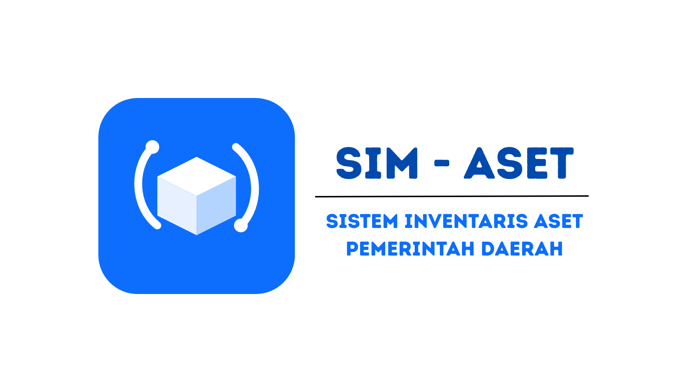
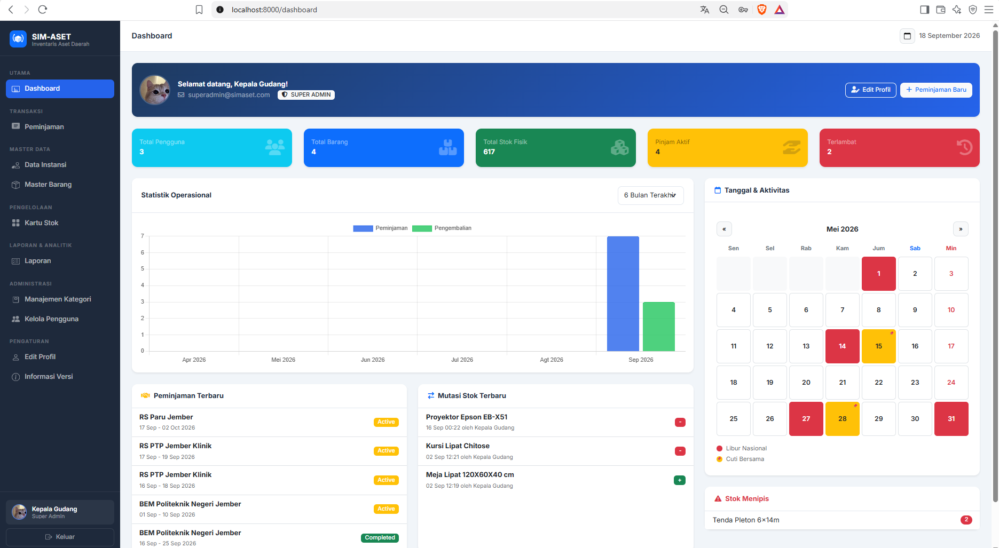
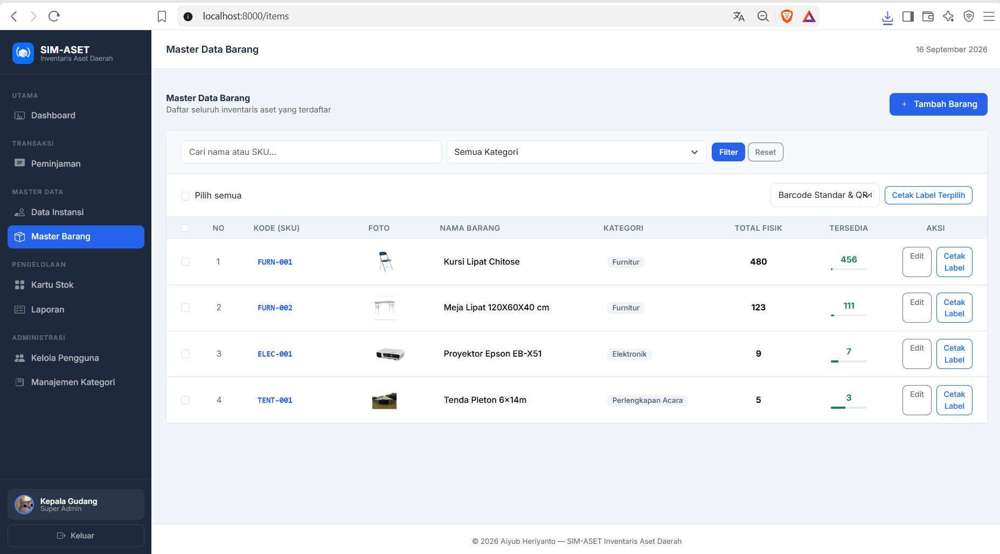
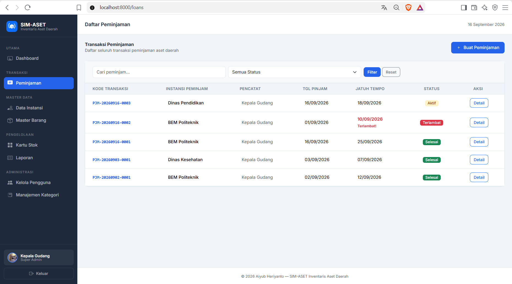
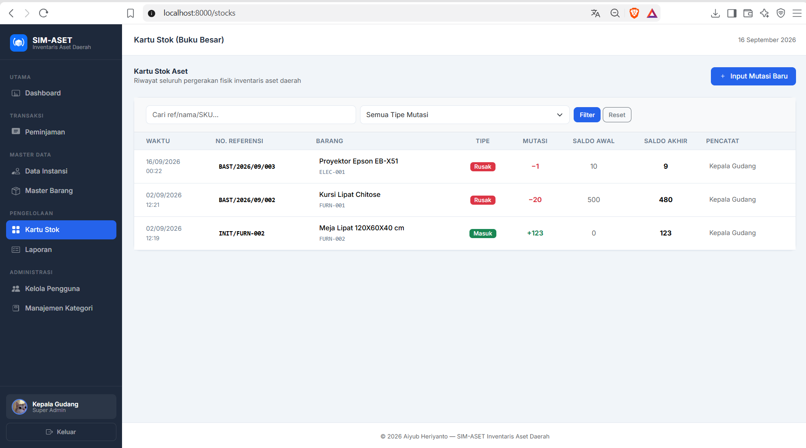
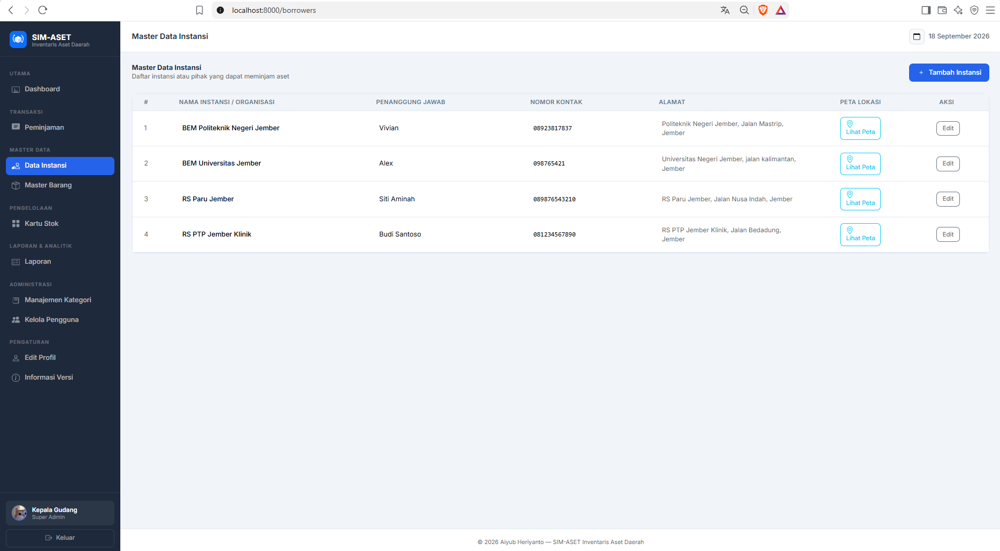
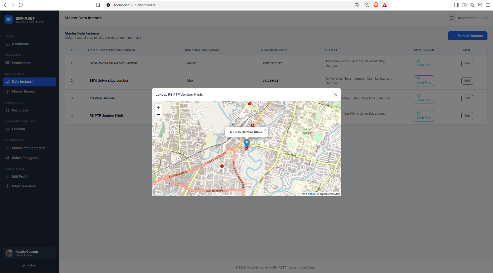
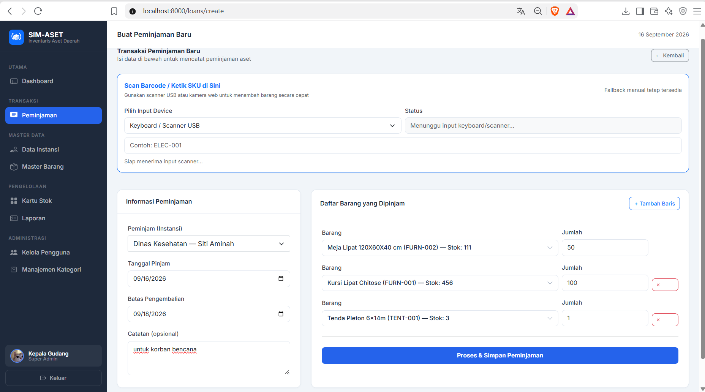
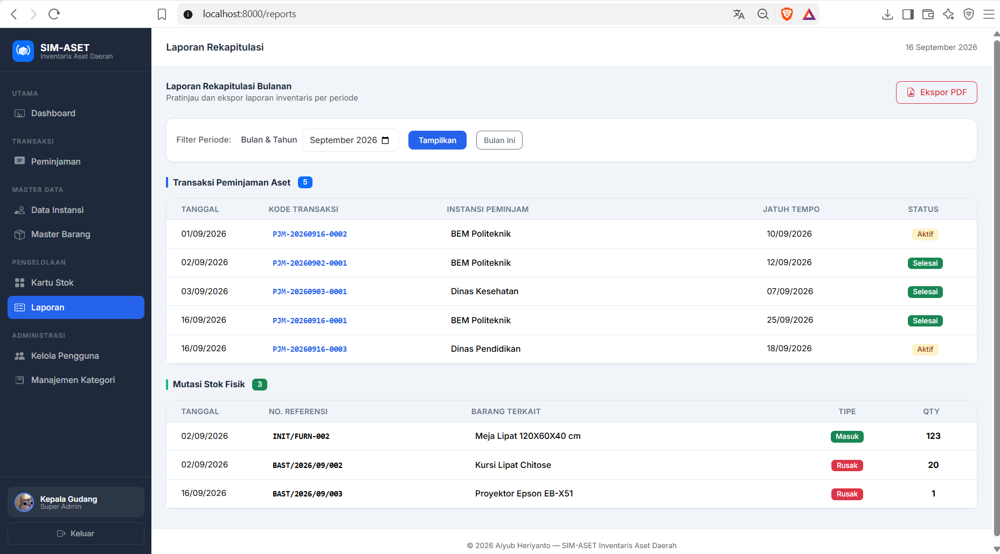

# SIM-ASET: Technical Documentation

[](https://github.com/Aiyub150/SIM-ASET)
[](https://laravel.com)
[](https://php.net)
[](LICENSE)
[]()
[]()

<p align="center">
  
</p>

SIM-ASET adalah sistem informasi manajemen inventaris dan sirkulasi aset daerah modern yang dikembangkan dengan kerangka kerja **Laravel 12.x** dan **Bootstrap 5.x**. Repositori ini berisi dokumentasi arsitektur perangkat lunak, skema basis data, spesifikasi sistem, manajemen hak akses terdistribusi (*Dynamic RBAC Matrix*), serta panduan teknis operasional (rilis stabil mutakhir: **Versi 1.2.0**).

## Spesifikasi Teknis (Tech Stack)

*   **Backend Framework**: Laravel 12.x (Modern PHP Foundation)
*   **Runtime Engine**: PHP 8.2+
*   **Frontend UI & UX**: Bootstrap 5.x, FontAwesome 6 (Icon-Assisted Labels), Vanilla JavaScript ES6+, TomSelect (Dedicated Dropdown Search)
*   **Geospatial & Mapping**: Leaflet.js 1.9.4 & OpenStreetMap Nominatim Engine (Forward/Reverse Geocoding)
*   **Database Engine**: SQLite (Development/Testing) & MySQL 8.0+ / MariaDB 10.5+ (Production)
*   **Authentication & Authorization**: Laravel Breeze & Spatie Laravel-Permission (Dynamic Role-Based Access Control & User Direct Permission Overrides)
*   **Barcode & Hardware Integration**: Square 2D QR Code Generation, HTML5 Video Stream (`navigator.mediaDevices.getUserMedia`)
*   **Document & Export Engine**: `barryvdh/laravel-dompdf` (Laporan Bulanan & Panduan Resmi PDF)
*   **Testing Framework**: PHPUnit / Pest Test Suite (107 Tests, 666 Assertions Passing)

---

## Fitur Unggulan (Core Highlights v1.2.0)

### 1. Dynamic RBAC & Permission Matrix
*   **Manajemen Peran Fleksibel**: Super Admin dapat membuat, mengubah deskripsi, dan menghapus peran (*role*) kustom tanpa intervensi kode sumber (peran bawaan sistem seperti *Super Admin* dan *Admin* memiliki imunitas proteksi).
*   **Matriks Otorisasi Interaktif**: Tabel matriks izin berbasis modul yang dilengkapi dengan *Sticky Table Header* dan kolom identifikasi visual (*badge* bawaan peran vs izin khusus langsung).
*   **Izin Khusus Langsung (*User-Specific Direct Permissions*)**: Memberikan fleksibilitas pemberian hak akses individual kepada staf atau auditor tertentu tanpa harus mengubah peran dasarnya.

### 2. Manajemen Format Kode SKU Fleksibel
*   **Visual Anatomy Blocks**: Pratinjau interaktif pembedahan kode SKU secara visual (Prefix Kategori, Pemisah/Separator, dan Nomor Urut/Counter Padding).
*   **Live Preview & Validasi Unik Real-Time**: Input SKU otomatis mendeteksi bentrok dengan database via AJAX; jika duplikat, sistem langsung mengaktifkan notifikasi SweetAlert2 *"kode ini sudah digunakan"*.
*   **Legacy SKU Bulk Synchronization**: Utilitas sinkronisasi massal untuk merapikan SKU data lama agar seragam mengikuti formula format terbaru dengan perlindungan kebal (*immunity*) terhadap barang titipan vendor/instansi lain.

### 3. Peta Interaktif Geospasial di Modal Instansi
*   **Pencarian Alamat Cerdas (*Nominatim Engine*)**: Pengguna tidak perlu menghafal atau mengetik angka desimal Latitude/Longitude. Cukup ketik nama jalan, gedung, atau instansi di kotak pencarian peta Leaflet 280px.
*   **Draggable Pin & Reverse Geocoding**: Menggeser pin penanda secara otomatis mengisi alamat lengkap dan menyimpan koordinat spasial secara transparan melalui input tersembunyi.

### 4. Transaksi Peminjaman & Mutasi Zero-Redirect
*   **Modal Interaktif Pop-up**: Tambah barang inventaris, edit instansi, peminjaman baru, serta pelunasan pengembalian barang diselesaikan secara instan di dalam modal tanpa *page reload* atau *redirect*.
*   **Scanner Barcode & Live Photo Preview**: Terintegrasi langsung dengan kamera perangkat untuk pemindaian SKU fisik serta verifikasi unggah foto BAST / bukti serah terima barang.

### 5. Audit Trail & Log History dengan Inspeksi Visual
*   **Before-After Comparison Modal**: Riwayat modifikasi data aset menampilkan komparasi visual sebelum dan sesudah perubahan (*state comparison*).
*   **Filter TomSelect Terstandarisasi**: Panel filter modul dan aksi menggunakan *dedicated dropdown search* yang bersih dan bebas dari konflik teks placeholder.

---

## Arsitektur Sistem

Sistem ini menerapkan pola desain **MVC (Model-View-Controller)** yang dikombinasikan dengan **Service Layer Pattern** untuk mengisolasi *business logic* dari kontroler. 

### Alur Request (Request Lifecycle)
1. **Routing & Middleware**: Request masuk melalui `routes/web.php` dan disaring oleh middleware `auth` serta `role` (Spatie). Sistem menerapkan isolasi akses ketat (misal: `Staff Logistik` hanya memiliki akses ke rute peminjaman yang diotorisasi khusus untuk ID pengguna mereka).
2. **Form Request Validation**: Semua input mutasi (*POST/PUT*) divalidasi ketat melalui instance `FormRequest` bawaan Laravel untuk memfilter *payload* yang tidak valid dan mencegah *Cross-Site Scripting* (XSS).
3. **Controller**: Bertugas mengelola siklus penerimaan *request HTTP*, memanggil *Service Layer*, dan menyusun *response* (Instance View atau Object JSON).
4. **Service Layer**: Entitas inti logika (*business rules*) dipisahkan ke dalam folder `app/Services/` (contoh: `LoanService.php`, `StockService.php`).
5. **Database Transaction**: Seluruh operasi yang melibatkan multi-tabel dibungkus di dalam `DB::transaction` guna menjamin atomisitas transaksi. Jika *query* ke-2 gagal, perubahan *query* ke-1 akan di-*rollback*.
6. **Pessimistic Locking**: Mengimplementasikan konstruksi `lockForUpdate()` saat mengeksekusi kueri pada tabel `items`. Hal ini ditujukan untuk mencegah timbulnya *race condition* (inkonsistensi kalkulasi kolom `available_qty` jika dua atau lebih sesi sistem melakukan peminjaman/mutasi pada objek aset yang sama di milidetik yang bersamaan).

---

## Struktur Basis Data (Entity Relationship)

Skema sistem bergantung pada relasi transaksional yang berpusat pada integritas pergerakan stok barang:

*   **`users`**: Entitas pengguna yang direlasikan ke polimorfik tabel peran (Super Admin, Admin, Staff Logistik).
*   **`categories`**: Klasifikasi master aset. Memiliki kolom `prefix` untuk referensi pembentukan nomor seri / SKU secara dinamis saat instansiasi `items` baru.
*   **`items`**: Entitas barang/aset. Memiliki kolom fisik `total_qty` (akumulasi absolut) dan `available_qty` (stok sisa mutakhir yang bebas dipinjamkan).
*   **`borrowers`**: Entitas data peminjam institusi. Memuat meta spasial (`latitude` dan `longitude`).
*   **`stock_movements`**: Ledger/Buku Besar berbasis *append-only* (tidak boleh dihapus). Menampung log riwayat mutasi (in, out, broken, lost). Memiliki foreign key ke `items` dan `users` (sebagai pelaksana).
*   **`loans` & `loan_items`**: Header dan detail transaksi peminjaman (tipe *One-to-Many*). `loan_items` memiliki kolom state `return_qty` untuk mengakomodasi alur pengembalian secara parsial. State header `loans` dinyatakan selesai (*completed*) apabila agregasi nilai total `return_qty` di *child-table* seimbang dengan total `qty` pinjam.

---

## Integrasi & Penggunaan API Eksternal

### 1. Kemendesa API (Libur Nasional)
*   **Fungsi**: Restorasi data agregat hari libur nasional dan cuti bersama pada modul *Dashboard* untuk menyajikan konteks operasional.
*   **Implementasi**: 
    *   Koneksi HTTP Endpoint: `https://api.kemendesa.link/libur-nasional/api/holidays/{tahun}.json`
    *   Panggilan API diinkapsulasi dalam kelas `CalendarService` di sisi server (Backend PHP) menggunakan fasad `Http` guna menghindari pembatasan *CORS* pada *Browser*.
    *   **Caching Strategy**: JSON Payload di-*cache* (diingat dalam memori sistem via `Cache::remember`) selama *Time-to-Live* (TTL) 24 jam dengan struktur *key* spesifik per kombinasi bulan/tahun (cth: `holidays_2026_9`). Hal ini sangat krusial untuk menekan *request limit* HTTP dan menjamin redundansi (dasbor tetap menyala) tatkala node server API Kemendesa mengalami *downtime*.

### 2. Leaflet.js (Geospasial / Web Mapping)
*   **Fungsi**: Membaca, menentukan, dan menyimpan vektor koordinat (*latitude/longitude*) dari entitas institusi `borrowers`.
*   **Implementasi**:
    *   Distribusi modul JS dan CSS dilayani secara statis melalui CDN eksternal *unpkg*.
    *   **Data Input (`create/edit`)**: Rutinitas JavaScript mengikat *listener* *event* `dragend` pada L.marker dan *event* `click` pada grid peta untuk mengekstrak objek `latlng` yang langsung dialirkan mutasinya ke *hidden DOM input field*.
    *   **Data Render (`index`)**: Mencegah pemuatan masif lapisan *TileLayer* pada seluruh indeks tabel (penyebab utama *out of memory / memory leak*). Leaflet hanya diinisialisasi melalui injeksi DOM (*mount*) di dalam *Lifecycle event Modal Bootstrap* (`shown.bs.modal`) secara sekuensial (*on-demand*) pada baris spesifik yang ditekan pengguna.

### 3. MediaDevices API / WebRTC (Barcode Scanner)
*   **Fungsi**: Akuisisi data string SKU perangkat keras pada antarmuka *Loans* tanpa instrumen input manual.
*   **Implementasi**:
    *   Memanfaatkan antarmuka API HTML5 `navigator.mediaDevices.getUserMedia()` untuk integrasi aliran video *real-time*.
    *   **Syarat Infrastruktur / Policy**: API modern ini diikat oleh standard keamanan W3C yang mewajibkan protokol jaringan **HTTPS (Secure Context)**. Browser modern akan secara sepihak memblokir izin akses *hardware stream* jika layanan diakses melalui protokol tidak aman (*HTTP*) di luar ranah `localhost`. *Deployment* ke fase *Staging* atau *Production* harus difasilitasi oleh sertifikat *SSL/TLS*.

---

## Preview Antarmuka Sistem (Visual Documentation)

Pratinjau visual modul operasional dan administratif pada **SIM-ASET v1.2.0**:

### 1. Modul Utama & Dasbor Inventaris
| Dashboard Eksekutif | Master Data Barang & Status Kepemilikan |
| :---: | :---: |
|  |  |

---

### 2. Transaksi Peminjaman & Buku Besar Mutasi Stok
| Transaksi Peminjaman (Multi-Barang) | Kartu Stok / Ledger Mutasi Aset |
| :---: | :---: |
|  |  |

---

### 3. Geospasial Instansi & Pelaporan Resmi
| Direktori Peminjam Instansi | Peta Lokasi Interaktif Leaflet |
| :---: | :---: |
|  |  |

| Formulir Peminjaman & Scanner Barcode | Laporan Rekapitulasi & Ekspor Dokumen |
| :---: | :---: |
|  |  |

---

---

## Keamanan Data (Security & Boundaries)

1.  **Data Isolation Constraint (Tenant-like Boundaries)**:
    Pengguna yang diikat pada peran `Staff Logistik` dipaksa patuh pada klausa kueri Eloquent global berbasis *identifier* (e.g., `where('user_id', auth()->id())`) pada lapis *Controller*. Skema arsitektur ini memisahkan blok data yang memungkinkan Staf A dicegah secara *backend* untuk melakukan *read, update,* maupun injeksi memanipulasi *ID Payload* peminjaman milik Staf B di *route endpoint* yang terekspos manapun.
2.  **Cross-Site Scripting (XSS) Mitigation**:
    *   Render DOM Sinkronus: *Output buffer* melalui mesin Blade ditangani oleh sintaks eksklusif `{{ }}` yang secara internal mengeksekusi instruksi `htmlspecialchars` bawaan PHP.
    *   Render DOM Asinkronus (AJAX): Respon tipe `application/json` yang dikonsumsi oleh blok perulangan JavaScript disanitasi menggunakan fungsi implementasi *context-aware escaping* yang merubah kode injeksi skrip (`<`, `>`, `&`, `"`, `'`) menjadi format HTML *entities* yang aman (*harmless*) sebelum disisipkan melalui *property* `innerHTML`.
    *   Middleware Sanitasi `XssSanitizer`: Memangkas script berbahaya dan entity encoding berbahaya pada seluruh request mutasi.
3.  **OWASP Security Headers**:
    Mengimplementasikan `SecurityHeadersMiddleware` yang menyuntikkan standar proteksi web:
    *   `X-Frame-Options: SAMEORIGIN` (mitigasi Clickjacking)
    *   `X-Content-Type-Options: nosniff` (mitigasi MIME confusion)
    *   `Referrer-Policy: strict-origin-when-cross-origin`
    *   `Permissions-Policy: camera=(self), microphone=(), geolocation=(), payment=()`
    *   `Strict-Transport-Security (HSTS)` saat HTTPS aktif
    *   `Content-Security-Policy (CSP)` membatasi script dan resource hanya ke internal dan CDN terdaftar
    *   Penyembunyian header identifikasi server `X-Powered-By`.
4.  **Brute-Force & Rate Limiting**:
    Pembatasan ketat percobaan autentikasi via middleware `throttle:5,1` pada rute `POST /login`.
5.  **Audit Trail & Trusted Proxies**:
    *   Konfigurasi `trustProxies` resmi di `bootstrap/app.php` untuk mencegah spoofing header `X-Forwarded-For`.
    *   `ActivityLogger` mencatat IP asli pengguna secara akurat ke tabel `activity_logs`.

---

## Catatan Rilis & Pembaruan (Changelog)

### [1.2.0] - 2026-10-22
*   **Fitur Baru (Enterprise Administration & Security)**:
    *   **Dynamic RBAC & Role Management**: Pembuatan, pengeditan, dan penghapusan peran kustom dengan isolasi imunitas pada peran default sistem.
    *   **User-Specific Direct Permissions**: Pengaturan izin khusus per akun pengguna tanpa merombak peran bawaan.
    *   **SKU Code Format Setting**: Pengaturan format kode SKU dengan blok anatomi visual, pilihan pemisah (`-`, `/`, `.`), counter padding, serta utilitas *Bulk Legacy Synchronization*.
    *   **Visual Before-After Audit Comparison**: Modal inspeksi log history yang menampilkan perbandingan visual nilai lama vs nilai baru data yang diubah.
*   **Peningkatan Antarmuka & UX**:
    *   **Peta Interaktif Leaflet di Modal Instansi**: Menghapus input manual Lat/Long dengan integrasi peta Leaflet 280px, pencarian alamat otomatis Nominatim, dan draggable marker.
    *   **Status Kepemilikan Barang Bertema**: Kartu kepemilikan aset (*Milik Sendiri*, *Milik Vendor*, *Instansi Lain*) dengan styling warna lembut saat aktif, efek hover dinamis, dan teks hitam bersih saat tidak dipilih.
    *   **Input SKU Dinamis pada Modal Edit**: Field SKU terkunci permanen untuk aset internal, namun otomatis terbuka untuk aset vendor/instansi dengan validasi duplikasi real-time via AJAX dan dialog SweetAlert2 *"kode ini sudah digunakan"*.
    *   **Icon-Assisted Form Labels**: Penambahan ikon FontAwesome pada seluruh keterangan form modal untuk mempermudah pemahaman kognitif pengguna awam.
    *   **Dedicated Dropdown TomSelect**: Standarisasi seluruh filter pencarian dan pilihan pengguna menggunakan plugin `dropdown_input` terpisah guna mencegah teks pencarian bertumpuk dengan placeholder.
*   **Pengujian & Verifikasi**:
    *   107 automated tests (666 assertions) lulus 100% pada suite PHPUnit/Pest.

### [1.1.0] - 2026-10-12
* **Fitur Baru (Super Admin)**:
  * **Modul Log Server**: Pemantau riwayat log aplikasi Laravel secara live dengan filter tingkatan log (Info, Warning, Error), unduh berkas, dan utilitas pembersihan log berbasis dialog SweetAlert2. Dilengkapi resolver IP pengguna riil (bukan IP server proxy).
  * **Modul Log History (Audit Trail)**: Pencatatan otomatis setiap aktivitas penting sistem (Login, Logout, Peminjaman, Mutasi Stok, Barang, Kategori, User) dengan inspeksi detail payload JSON.
* **Peningkatan Keamanan (OWASP Compliance)**:
  * Implementasi `SecurityHeadersMiddleware` (CSP, HSTS, X-Frame-Options, nosniff, dll.).
  * Mitigasi BFCache & History Leakage (CWE-525) dengan *Strict Anti-Cache Headers* (`no-store, no-cache, must-revalidate`) dan `Clear-Site-Data: "cache", "storage"` saat logout.
  * Invalidation client-side via listener `pageshow` di master layout yang memaksa reload/redirect ke `/login` jika tombol back/undo ditekan pasca logout.
  * Proteksi DoS & Brute-Force melalui *Rate Limiting* menyeluruh pada Login, Lupa Password, Ekspor PDF Laporan, Cetak Label Barcode, Operasi Log Server, dan Mutasi Transaksi Operasional.
  * Konfigurasi *trusted proxies* untuk integritas evaluasi IP pengguna.
  * Patch keamanan dependensi kritis (`shell-quote` dan `league/commonmark`).
  * Automated regression test suite untuk seluruh matriks otorisasi RBAC (36 endpoint) dan Rate Limiting / Anti-Cache (61 feature tests).
* **Peningkatan Antarmuka & UX**:
  * Tampilan thumbnail foto profil/avatar pengguna (36px) pada tabel manajemen pengguna.
  * Standarisasi cetak label inventaris berbasis 2D QR Code.
  * Perbaikan interaktivitas accordion FAQ dan keseragaman kartu flexbox pada halaman Buku Panduan (`/guide`) serta template PDF resmi.

### [1.0.0] - 2026-09-01
* Rilis perdana sistem SIM-ASET dengan fitur inti: Dashboard ringkasan aset, Master Barang & SKU otomatis, Peminjam & Peta Interaktif Leaflet, Transaksi Peminjaman multi-barang, Kartu Stok / Ledger Mutasi, Laporan Bulanan & Ekspor PDF, serta Manajemen Peran (Super Admin, Admin, Staff Logistik).

---

## Panduan Pemasangan (Environment Setup)

1. **Clone Repositori & Instalasi Dependensi Inti**:
   ```bash
   git clone https://github.com/Aiyub150/SIM-ASET.git
   cd SIM-ASET
   composer install
   npm install && npm run build
   ```

2. **Konfigurasi Parameter Lingkungan (*Environment*)**:
   ```bash
   copy .env.example .env
   php artisan key:generate
   ```
   *(Penyesuaian `DB_CONNECTION` dapat diedit pada konfigurasi `.env`. Lingkungan lokal akan memanfaatkan SQLite).*

3. **Migrasi Schema & Bootstraping Metadata (Seeding)**:
   ```bash
   touch database/database.sqlite
   php artisan migrate:fresh --seed
   ```
   *(Rutinitas `seeder` akan membangun indeks izin peran Spatie dan menyuntikkan 3 pengguna penguji/administrator default).*

4. **Eksekusi Layanan Web Server**:
   ```bash
   php artisan serve --port=5000
   ```
   *(Pekerja layanan mendengarkan koneksi pada *port* standar HTTP lokal `http://localhost:5000`).*